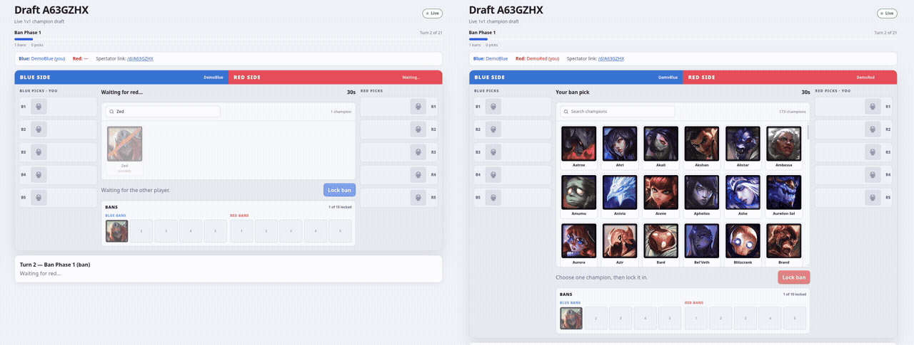

# LoL 1v1 Draft Strategy Board

A real-time 1v1 League of Legends draft simulator. Two authenticated players
create a room, claim Blue or Red, and work through the full 21-turn draft
schedule. Bans and picks are server-authoritative, synchronized over
Socket.IO, and available to spectators through a read-only public link.



*Both players side by side — Blue on the left, Red on the right — searching,
staging and locking bans and picks.*

## Features

- **Real-time 1v1 drafting** — WebSocket-synchronized ban/pick phases with a
  lock mechanism and server-authoritative 30-second action timers.
- **Official draft order** — Ban Phase 1, Pick Phase 1, Ban Phase 2, Pick
  Phase 2, and a 60-second Finalization window.
- **Deterministic timeouts** — an expired turn locks the staged champion,
  picks the first available champion for an unstaged pick, or skips an
  unstaged ban.
- **Public viewing** — link-based spectator access without an account. Staged
  selections are never included in public broadcasts.
- **Champion data** — Riot's public Data Dragon CDN, patch-aware Redis cache,
  and no developer API key.
- **Single-draft scope** — one 1v1 draft per room. Multi-game series formats,
  champion-lock restrictions, matchmaking, and 5v5 drafting are intentionally
  out of scope.
- **Local-first deployment** — four runtime services plus a one-shot database
  migration job, all managed by Docker Compose.

## Tech stack

| Layer | Technology |
|---|---|
| Frontend | Next.js 16 (React 19, TypeScript), Socket.IO client, Zustand |
| Backend | NestJS 11 (TypeScript), Socket.IO server, JWT auth |
| Database | PostgreSQL 15 with Prisma 7 migrations |
| Cache / live state | Redis 7 (sessions, refresh tokens, rate limits, champion cache) |
| Runtime | Node.js 22 Alpine containers, Docker Compose |

## Quickstart

Prerequisites: Docker with the Compose plugin.

```bash
# 1. Create the local environment file with strong secrets
cp .env.example .env
sed -i 's/^JWT_SECRET=.*/JWT_SECRET='"$(openssl rand -hex 32)"'/' .env
sed -i 's/^POSTGRES_PASSWORD=.*/POSTGRES_PASSWORD='"$(openssl rand -hex 24)"'/' .env

# 2. Build, migrate, and start the stack
docker compose up -d --build --wait

# 3. Verify
curl http://127.0.0.1:4000/health
curl http://127.0.0.1:4000/champions
open http://127.0.0.1:3000
```

The one-shot `migrate` service applies the Prisma migrations before the API
starts, so a fresh database volume is initialized automatically. See
[`docs/local-development.md`](docs/local-development.md) for manual (non-Docker)
development and database setup.

## Services

| Service | Port | Role |
|---|---|---|
| `web` | 3000 | Next.js frontend (standalone build) |
| `api` | 4000 | NestJS HTTP API + Socket.IO server |
| `db` | 5432 | PostgreSQL 15 — database `league_draft`, schema `draft_db` |
| `redis` | 6379 | Redis 7 (AOF persistence) |
| `migrate` | — | One-shot Prisma migration runner; exits before `api` starts |

All published ports bind to `127.0.0.1` only. The stack is designed for a
trusted local or private host; see [`docs/security.md`](docs/security.md).

## Documentation

- [`docs/local-development.md`](docs/local-development.md) — prerequisites,
  environment configuration, database initialization, and local startup.
- [`docs/participant-guide.md`](docs/participant-guide.md) — creating a room,
  side selection, bans, picks, timers, finalization, and public viewing.
- [`docs/account-session.md`](docs/account-session.md) — registration, login,
  token refresh, logout, and session behavior.
- [`docs/draft-rooms.md`](docs/draft-rooms.md) — draft creation, code sharing,
  side assignment, and waiting-room cleanup.
- [`docs/spectator-viewing.md`](docs/spectator-viewing.md) — spectator links
  and what public viewers can see.
- [`docs/api.md`](docs/api.md) — HTTP and Socket.IO contracts, payloads, and
  error shapes.
- [`docs/troubleshooting.md`](docs/troubleshooting.md) — invalid codes,
  expired drafts, champion-data outages, auth failures, and connection loss.
- [`docs/ci.md`](docs/ci.md) — CI prerequisites, secrets, and local
  reproduction commands.
- [`docs/security.md`](docs/security.md) — trust boundary, secret handling, and
  deployment assumptions.
- [`docker/README.md`](docker/README.md) — container topology, health checks,
  smoke test, and teardown.

## Repository structure

```
frontend/    Next.js app (Dockerfile included)
backend/     NestJS app, Prisma schema/migrations, tests (Dockerfile included)
docker/      Container topology documentation
scripts/     Database bootstrap, smoke test, documentation check
docs/        User, API, security, and operations documentation
openspec/    Planning artifacts: proposal, design, specs, tasks
.github/     GitHub Actions CI and image publishing workflow
```

## Status

The single-draft feature set is implemented and covered by backend
integration/unit tests, frontend component/accessibility tests, an end-to-end
Compose draft test, and a security regression suite. The completed OpenSpec
planning artifacts are archived in
`openspec/changes/archive/2026-11-23-lol-draft-strategy-board/`, and the main
behavior specification is in `openspec/specs/draft-system/spec.md`.
