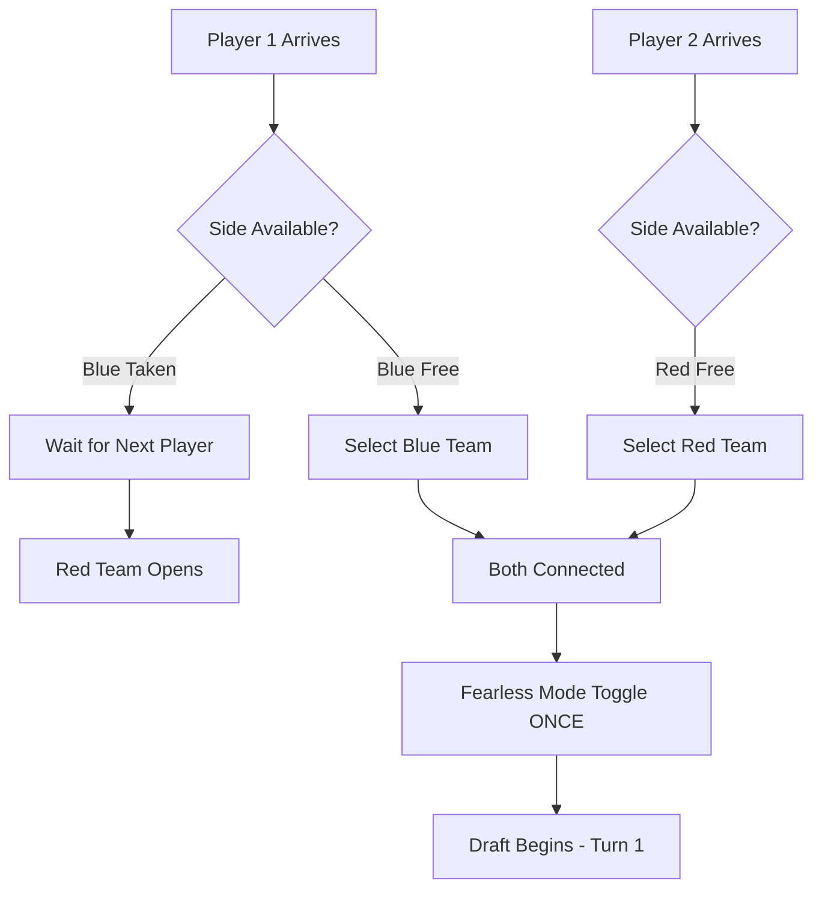
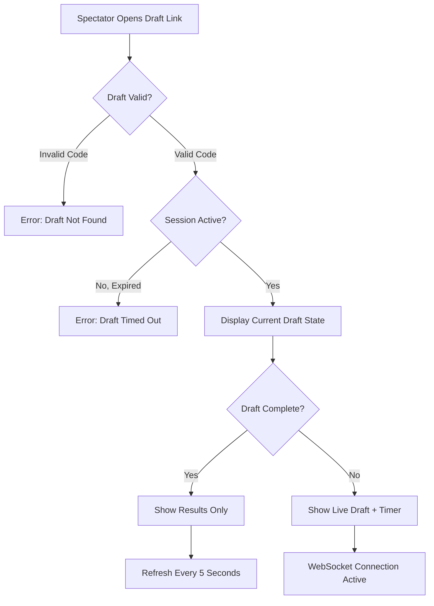

# Draft System Specification

## Overview

The draft system orchestrates the complete champion selection and banning process for 1v1 League of Legends matches, implementing official LoL drafting rules with real-time synchronization.

---

## Functional Requirements

### R-001: Two Player Authentication
**ID**: DS-FR-001  
**Description**: The system shall support exactly two authenticated players per draft session.  
**Acceptance Criteria**:
- Both players must complete login to begin drafting
- Invalid or missing authentication results in "Draft Not Found" error
- Draft cannot start until both players are connected

### R-002: Side Assignment (First-Come First-Served)
**ID**: DS-FR-002  
**Description**: Players shall choose their team side upon joining, with Blue Team receiving first pick.  
**Acceptance Criteria**:
- Player 1 chooses Blue Team → receives Turn 7 pick (first overall)
- Player 2 chooses Red Team → receives Turn 8 pick (last overall)
- Side selection is locked once confirmed
- Cannot change sides after draft begins

### R-003: Ban Phase 1 Implementation
**ID**: DS-FR-003  
**Description**: Ban Phase 1 consists of 6 turns with 3 bans per team. Blue Team initiates first ban.  
**Acceptance Criteria**:
| Turn | Action | Duration |
|------|--------|----------|
| 1 | Blue bans #1 | 30s |
| 2 | Red bans #1 | 30s |
| 3 | Blue bans #2 | 30s |
| 4 | Red bans #2 | 30s |
| 5 | Blue bans #3 | 30s |
| 6 | Red bans #3 | 30s |

**Acceptance Criteria**:
- Each ban is visible to opponent immediately upon locking/timeout
- Banned champions removed from available pool instantly
- Cannot re-ban previously banned champion

### R-004: Pick Phase 1 Implementation
**ID**: DS-FR-004  
**Description**: Pick Phase 1 consists of 6 turns with asymmetric pick distribution.  
**Acceptance Criteria**:
| Turn | Action | Duration | Notes |
|------|--------|----------|-------|
| 7 | Blue picks #1 | 30s | First overall pick |
| 8 | Red picks #1 | 30s | - |
| 9 | Red picks #2 | 30s | Red advantage turn |
| 10 | Blue picks #2 | 30s | - |
| 11 | Blue picks #3 | 30s | - |
| 12 | Red picks #3 | 30s | Last pick P1 |

**Acceptance Criteria**:
- Each pick is visible to opponent immediately upon locking/timeout
- Picks cannot be changed after lock without swap in Finalization
- Champion pool updates in real-time

### R-005: Ban Phase 2 Implementation
**ID**: DS-FR-005  
**Description**: Ban Phase 2 consists of 4 turns with 2 bans per team. Red Team initiates first ban.  
**Acceptance Criteria**:
| Turn | Action | Duration |
|------|--------|----------|
| 13 | Red bans #4 | 30s |
| 14 | Blue bans #4 | 30s |
| 15 | Red bans #5 | 30s |
| 16 | Blue bans #5 | 30s |

**Acceptance Criteria**:
- All banned champions from both phases cannot be picked
- Cannot ban already banned champion
- Can still ban Phase 1 picks if not in Fearless mode

### R-006: Pick Phase 2 Implementation
**ID**: DS-FR-006  
**Description**: Pick Phase 2 consists of 4 turns with asymmetric pick distribution favoring Blue.  
**Acceptance Criteria**:
| Turn | Action | Duration | Notes |
|------|--------|----------|-------|
| 17 | Red picks #4 | 30s | Counter-picks to Phase 2 bans |
| 18 | Blue picks #4 | 30s | Blue advantage turn |
| 19 | Blue picks #5 | 30s | - |
| 20 | Red picks #5 | 30s | Last pick P2 |

**Acceptance Criteria**:
- Final picks complete main drafting phase
- Total: Blue = 5 picks, Red = 5 picks

### R-007: Finalization Phase Implementation
**ID**: DS-FR-007  
**Description**: Finalization Phase is a 60-second grace period for champion swaps before game begins.  
**Acceptance Criteria**:
| Turn | Action | Duration |
|------|--------|----------|
| 21 | Champion Swap Grace Period | 60s |

**Acceptance Criteria**:
- Either player can request swap with opponent's pick
- Opponent approves or rejects within reason
- All swap requests visible to both players
- Draft locks automatically when timer expires

### R-008: Real-time Synchronization
**ID**: DS-FR-008  
**Description**: All ban and pick actions must synchronize between clients within 500ms.  
**Acceptance Criteria**:
- Ban/pick broadcasts to opponent client immediately upon lock/timeout
- Client state updates reflect server authoritative decision
- No visual "lag" visible during normal operation

### R-009: Lock Mechanism
**ID**: DS-FR-009  
**Description**: Players can commit selections early using a "Lock This [Ban/Pick]" button.  
**Acceptance Criteria**:
- Champion selection is pending until locked or 30s timeout
- Player can change selection before lock confirmation
- Once locked, cannot be changed without swap
- Auto-lock on 30s countdown completion

### R-010: Timer Management
**ID**: DS-FR-010  
**Description**: All ban and pick phases use standardized 30-second timers per action. Finalization uses 60-second timer.  
**Acceptance Criteria**:
- Visual countdown displayed prominently
- Warning states at 5s, 3s, 1s
- Timer resets only after lock/timeout confirmation
- Next turn begins automatically

### R-011: Champion Pool Management
**ID**: DS-FR-011  
**Description**: System maintains accurate ban/pick state for all available champions.  
**Acceptance Criteria**:
- Champions marked as banned appear crossed-out or grayed
- Champions marked as picked are unavailable to both players
- Real-time pool updates after each action
- Total champion count: 140+ (all Riot API champions)

### R-012: Lock Persistence
**ID**: DS-FR-012  
**Description**: Locked bans and picks persist in state until draft completion.  
**Acceptance Criteria**:
- Draft state saved to Redis for live session
- Cannot revoke lock after confirmation
- Reconnection restores last known state

### R-013: Network Resilience
**ID**: DS-FR-013  
**Description**: System handles disconnections and reconnections gracefully.  
**Acceptance Criteria**:
- Player disconnected 30s+ cannot recover draft
- Draft auto-deletes after timeout period
- Reconnected player receives current state immediately

### R-014: Draft Completion
**ID**: DS-FR-014  
**Description**: System transitions to complete state after Finalization Phase.  
**Acceptance Criteria**:
- All 5 picks per player confirmed and locked
- Finalization timer expired
- Results saved to PostgreSQL database
- Public viewing link remains active for reconnection

---

## Non-Functional Requirements

### DS-NF-001: Performance
- Ban/pick broadcast latency: < 500ms (p95)
- Timer accuracy: ±1 second
- Client-side rendering: < 100ms per state update

### DS-NF-002: Availability
- Real-time connection uptime: 99.5%
- Draft persistence during disconnection: 30s grace period
- Auto-reconnection success rate: > 98%

### DS-NF-003: Security
- Authentication required for draft participation
- No unauthenticated modification of draft state
- All actions validated server-side before broadcast

---

## Data Structures

### Draft State Schema
```typescript
interface DraftState {
  id: string;
  code: string; // Public access link code
  blueTeamId: string; // Player ID who chose Blue
  redTeamId: string; // Player ID who chose Red
  
  fearlessMode: boolean; // Set before draft starts
  status: 'IN_PROGRESS' | 'WAITING_FOR_PLAYERS' | 'COMPLETE' | 'EXPIRED';
  
  // Ban states: { championId: boolean }
  bansPhase1: Record<string, boolean>; // Blue first
  bansPhase2: Record<string, boolean>; // Red first
  
  // Pick states: { playerId: Champion[] }
  bluePicks: Champion[]; // Total: 5 champions
  redPicks: Champion[]; // Total: 5 champions
  
  // Current phase tracking
  currentTurn: number; // 1-21
  currentPhase: 'BANNING_P1' | 'PICKING_P1' | 'BANNING_P2' | 'PICKING_P2' | 'FINALIZATION';
  
  // Timing
  createdAt: Date;
  updatedAt: Date;
}
```

### Turn State Schema
```typescript
interface TurnState {
  id: string;
  turnNumber: number;
  phase: TurnPhase;
  actionType: 'BAN' | 'PICK';
  expectedTeam: 'BLUE' | 'RED';
  
  selectedChampionId?: string;
  isLocked: boolean;
  lockType: 'MANUAL' | 'AUTO'; // For analytics only
  
  timerSeconds: number; // Remaining time (0-30)
  state: 'WAITING' | 'LOCKED' | 'COMPLETED';
  
  createdAt: Date;
}
```

---

## User Flows

### Draft Start Flow


### Ban/Pick Action Flow
```mermaid
graph TD
    A[Player's Turn Starts] --> B{Has Selection?}
    B -->|No| C[Click Champion to Select]
    B -->|Yes| E[Skip to Lock]
    
    C --> D{Change Selection?}
    D -->|Yes| C
    
    E --> F[Click \"Lock Button\"]
    D -->|No| F
    
    F --> G{Manual Lock Success?}
    G -->|Yes| H[Broadcast to Opponent]
    G -->|No (Timeout First)| I[Auto-Lock Current Selection]
    
    H --> J[Update State & DB]
    I --> J
    
    J --> K[Start Next Turn Timer]
    K --> A
```

### Public Viewing Flow


---

## Edge Cases & Error Handling

### EC-001: Opponent Disconnects
**Scenario**: Player locks pick, opponent disconnects immediately after  
**Handling**: 
- System acknowledges lock to server
- Server persists state before broadcasting
- Opponent reconnection restores last known state within 30s
- After 30s, draft expires automatically

### EC-002: Network Latency Spike
**Scenario**: Internet connection experiences packet loss  
**Handling**:
- Client maintains local state buffer
- Queue ban/pick actions locally
- Replay queued actions when connection restored
- Server validates and reconciles on reconnection

### EC-003: Riot API Unavailability
**Scenario**: Riot Games Developer Portal API is down  
**Handling**:
- Redis cache serves champions data (TTL: 24h)
- Fallback retry with exponential backoff
- Display "Champion pool unavailable" error if all retries fail

### EC-004: Invalid Draft Code
**Scenario**: Spectator enters expired or non-existent draft link  
**Handling**:
- Server validates code against database
- Return standardized error message
- No information leaked about draft status

---

## Acceptance Testing Scenarios

### TS-001: Complete Draft Sequence
**Steps**:
1. Create new draft, invite friend
2. Complete all 6 ban turns without timeout
3. Complete all 6 pick turns with manual locks
4. Complete Ban P2 (4 turns) and Pick P2 (4 turns)
5. Execute champion swaps in Finalization
6. Draft completes successfully

**Expected**: All phases complete within ~14 minutes, final state saved to database

### TS-002: Timeout Recovery
**Steps**:
1. Player selects champion but doesn't lock
2. Opponent leaves and returns after 15s
3. First player locks before timeout
4. Opponent rejoins draft after 25s total

**Expected**: State restored accurately, no data loss

### TS-003: Fearless Mode Validation
**Steps**:
1. Enable Fearless mode before draft starts
2. Make a pick in Pick P1
3. Attempt to ban that champion in Ban P2

**Expected**: Ban request rejected with "Already picked" error

---

## Related Artifacts

- Design Document: `design.md`
- Task Breakdown: `tasks.md`
- API Specifications: Riot Games v4 Datastore documentation
